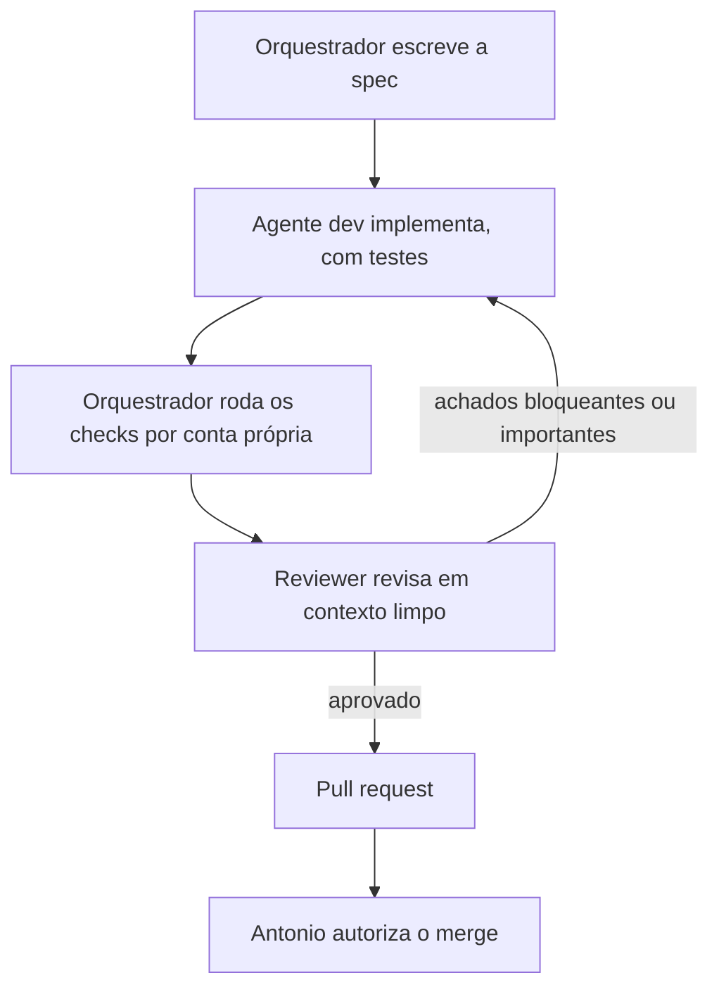

# CampZone

SaaS multi-tenant para organizar campeonatos de qualquer modalidade (futebol, xadrez, esports), com pontos corridos e mata-mata configuráveis.

**Este projeto é desenvolvido por agentes de IA, com um humano no comando.** O código é escrito pelos agentes do [Claude Code](https://claude.com/claude-code). O Antonio ([@Attonic](https://github.com/Attonic)) decide o produto e autoriza cada merge. Este README explica como isso funciona.

> **Status: em desenvolvimento.** Veja [o que já existe](#o-que-já-existe).

| Repositório | Conteúdo |
|---|---|
| [campzone-backend](https://github.com/Attonic/campzone-backend) | Java 21, Spring Boot 4, PostgreSQL, JWT |
| [campzone-frontend](https://github.com/Attonic/campzone-frontend) | React, TypeScript, Vite |

## Como os agentes trabalham

Cada agente tem um papel, um escopo e regras próprias. Eles estão definidos em [`.claude/agents/`](.claude/agents):

| Agente | Papel | Limite |
|---|---|---|
| Orquestrador (sessão principal) | Escreve a spec, coordena, confere e mantém o backlog | Não escreve código de feature |
| `dev-back` | Implementa as tarefas do backend | Só mexe em `backend/` |
| `dev-front` | Implementa as tarefas do frontend | Só mexe em `frontend/` |
| `reviewer` | Revisa o diff em contexto limpo, sem ter visto o desenvolvimento | Somente leitura |

Cada tarefa do [backlog](docs/BACKLOG.md) passa pelo mesmo ciclo:

As regras que mantêm esse ciclo honesto:

- **Spec antes do código:** cada tarefa tem critérios de aceite e o contrato da API em [`docs/specs/`](docs/specs).
- **Ninguém confia no relatório de ninguém:** o orquestrador e o reviewer rodam os testes de novo.
- **Limite de 3 ciclos** entre dev e reviewer. Se não convergir, a decisão volta para o humano.
- **Decisões registradas:** as escolhas de arquitetura ficam em [`docs/adr/`](docs/adr).
- **Autoria visível:** os commits de agente levam o trailer `Co-Authored-By`.

As regras do projeto ficam no [`CLAUDE.md`](CLAUDE.md) e nos `CLAUDE.md` de cada repositório.

## Exemplos reais do processo

- **Revisão reprovou a autenticação (tarefa 02).** O reviewer achou senha acima de 72 bytes causando erro 500 e um perfil padrão inseguro: um deploy sem perfil subiria com segredos de desenvolvimento. Isso virou a [ADR 0004](docs/adr/0004-perfil-explicito-obrigatorio.md), e agora a aplicação não sobe sem perfil explícito.
- **O dev corrigiu o orquestrador (tarefa 04).** A fórmula de sorteio escrita na spec era viciada: confrontos vizinhos davam o mesmo lado em 99,9% dos casos. O `dev-back` mediu e apontou o problema, e a [ADR 0005](docs/adr/0005-interface-formato-competicao.md) foi corrigida, com um teste que pega a regressão.
- **Teste de mutação achou uma lacuna (tarefa 04).** Com 100% de cobertura, o reviewer alterou uma regra de propósito e todos os testes continuaram passando, porque os dados de teste tinham ids na mesma ordem das seeds. Isso voltou para o dev como achado.

## O que já existe

| Área | Situação |
|---|---|
| Scaffold, perfis dev/prod e CI | Pronto |
| Domínio e entidades | Pronto |
| Cadastro, login com JWT e isolamento multi-tenant | Pronto |
| Painel do admin da plataforma | Pronto |
| Motor de competição: pontos corridos | Pronto |
| Motor de competição: mata-mata | Em revisão |
| API de campeonatos, partidas e resultados | A fazer |
| Telas de campeonato e página pública | A fazer |

O andamento detalhado está no [backlog](docs/BACKLOG.md).

## Arquitetura em resumo

- **Monólito modular** no backend.
- **Motor de competição em Java puro:** sem Spring e sem banco, determinístico, com sorteios reprodutíveis por seed. Um teste garante essas regras.
- **Multi-tenant:** a organização vem sempre do JWT, nunca da requisição.
- **Regra de negócio só no backend:** o frontend exibe o que a API devolve.

## Como rodar

As instruções estão no README de cada repositório: [backend](https://github.com/Attonic/campzone-backend#readme) e [frontend](https://github.com/Attonic/campzone-frontend#readme).
